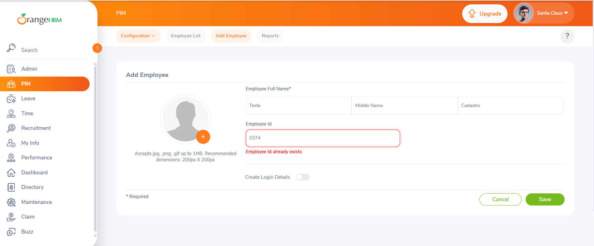

# Portfólio de QA: Testes Manuais no OrangeHRM

Projeto de portfólio que demonstra, na prática, a atuação em **Quality Assurance (QA)** por meio de testes manuais funcionais (caixa-preta) na aplicação OrangeHRM Demo.

O trabalho abrange elaboração de casos de teste, execução dos cenários, análise dos resultados, registro de evidências e documentação de defeitos.

## Resumo

| Casos executados | Aprovados | Reprovados | Defeitos registrados |
|---:|---:|---:|---:|
| 16 | 15 | 1 | 1 |

---

## Sistema Testado

**OrangeHRM Demo**: aplicação web de gestão de recursos humanos.

Acesso: https://opensource-demo.orangehrmlive.com/

## Ambiente de Teste

| Item | Detalhe |
|---|---|
| Navegador e versão | Google Chrome|
| Sistema operacional | Windows 11 |
| Período de execução | 10/2026 |
| Tipo de teste | Manual, funcional, caixa-preta |

---

## Escopo dos Testes

### Login (7 casos)

| ID | Cenário |
|---|---|
| CT-LOGIN-01 | Login com senha inválida |
| CT-LOGIN-02 | Login com usuário inválido |
| CT-LOGIN-03 | Login com usuário e senha inválidos |
| CT-LOGIN-04 | Login com credenciais válidas |
| CT-LOGIN-05 | Campos obrigatórios vazios |
| CT-LOGIN-06 | Usuário vazio |
| CT-LOGIN-07 | Senha vazia |

### PIM: Personnel Information Management (9 casos)

| ID | Cenário |
|---|---|
| CT-PIM-01 | Cadastro de funcionário com dados válidos |
| CT-PIM-02 | Validação de First Name obrigatório |
| CT-PIM-03 | Validação de Last Name obrigatório |
| CT-PIM-04 | Alteração do Employee ID |
| CT-PIM-05 | Cancelamento do cadastro |
| CT-PIM-06 | Validação de Username duplicado |
| CT-PIM-07 | Validação de senha e confirmação de senha |
| CT-PIM-08 | Validação de Employee ID duplicado |
| CT-PIM-09 | Geração automática de Employee ID |

---

## Resultados da Execução

| Módulo | Casos Executados | Aprovados | Reprovados |
|---|---:|---:|---:|
| Login | 7 | 7 | 0 |
| PIM | 9 | 8 | 1 |
| **Total** | **16** | **15** | **1** |

---

## Exemplos de Casos de Teste

Os casos completos estão nas planilhas da pasta [`test-cases-manual`](./test-cases-manual). Dois exemplos:

| ID | Título | Pré-condição | Passos | Dados de entrada | Resultado esperado |
|:--|:--|:--|:--|:--|:--|
| **CT-LOGIN-01** | Login com senha inválida | Usuário cadastrado no sistema | 1. Acessar a tela de Login 2. Informar usuário válido 3. Informar senha inválida 4. Clicar em "Login" | **Usuário:** Admin **Senha:** admin1 (inválida) | Usuário permanece na tela de Login, a autenticação não é realizada e a mensagem `Invalid credentials` é exibida. |
| **CT-LOGIN-05** | Campos vazios | Usuário cadastrado no sistema | 1. Acessar a tela de Login 2. Deixar usuário e senha em branco 3. Clicar em "Login" | **Usuário:** (vazio) **Senha:** (vazio) | Usuário permanece na tela de Login e a mensagem `Required` é exibida abaixo de ambos os campos. |

---

## Defeito Identificado

### BUG-PIM-001: Geração automática de Employee ID já existente

| Campo | Descrição |
|---|---|
| **Módulo** | PIM > Add Employee |
| **Severidade** | Média |
| **Prioridade** | Média |
| **Reprodutibilidade** | Reproduzido em mais de uma tentativa (comportamento intermitente) |
| **Evidência** | [BUG-PIM-001-anexo5.png](./evidences/prints/BUG-PIM-001-anexo5.png) |

**Passos para reproduzir**

1. Acessar o OrangeHRM Demo e fazer login.
2. Acessar o menu **PIM** e clicar em **Add Employee**.
3. Preencher **First Name** e **Last Name** com dados válidos.
4. Manter o campo **Employee ID** com o valor gerado automaticamente.
5. Clicar em **Save**.

**Resultado esperado:** o sistema gera automaticamente um Employee ID único e disponível, e o cadastro é concluído.

**Resultado obtido:** em algumas execuções, o sistema gerou um Employee ID que já estava cadastrado e exibiu a mensagem `Employee Id already exists`.

---

## Técnicas Aplicadas

- Testes funcionais
- Testes positivos e negativos
- Validação de campos obrigatórios
- Validação de dados duplicados
- Validação de mensagens de erro
- Comparação entre resultado esperado e resultado obtido
- Reexecução de cenários para confirmação de comportamento
- Identificação e documentação de defeitos

---

## Evidências

| Evidência | Arquivo |
|---|---|
| Login com senha inválida | [01-Login-com-senha-invalida.mp4](./evidences/videos/01-Login-com-senha-invalida.mp4) |
| Login com usuário inválido | [02-Login-com-usuario-invalido.mp4](./evidences/videos/02-Login-com-usuario-invalido.mp4) |
| Login com usuário e senha inválidos | [03-Login-com-usuario-e-Senha-invalidos.mp4](./evidences/videos/03-Login-com-usuario-e-Senha-invalidos.mp4) |
| CT-PIM-02: First Name vazio | [CT-PIM-02-First-Name-vazio.mp4](./evidences/videos/CT-PIM-02-First-Name-vazio.mp4) |
| BUG-PIM-001 | [BUG-PIM-001-anexo5.png](./evidences/prints/BUG-PIM-001-anexo5.png) |

---

## Documentação

| Item | Localização |
|---|---|
| Plano de teste | [docs/plano-de-teste.md](./docs/plano-de-teste.md) |
| Casos de teste (Login) | [test-cases-manual/Login-test-cases.xlsx](./test-cases-manual/Login-test-cases.xlsx) |
| Casos de teste (PIM) | [test-cases-manual/PIM-test-cases.xlsx](./test-cases-manual/PIM-test-cases.xlsx) |
| Evidências em vídeo | [evidences/videos](./evidences/videos) |
| Evidências em imagem | [evidences/prints](./evidences/prints) |

---

## Próximos Passos

- [ ] Automação dos principais cenários com Cypress e JavaScript
- [ ] Geração de relatórios de execução automatizada

---

## Autoria

Desenvolvido por **Karoliny Carvalho**, QA Júnior, com foco em testes manuais e funcionais, documentação de casos de teste e identificação de defeitos.

[LinkedIn](https://www.linkedin.com/in/karoliny-p-o-carvalho-10554b113/)
